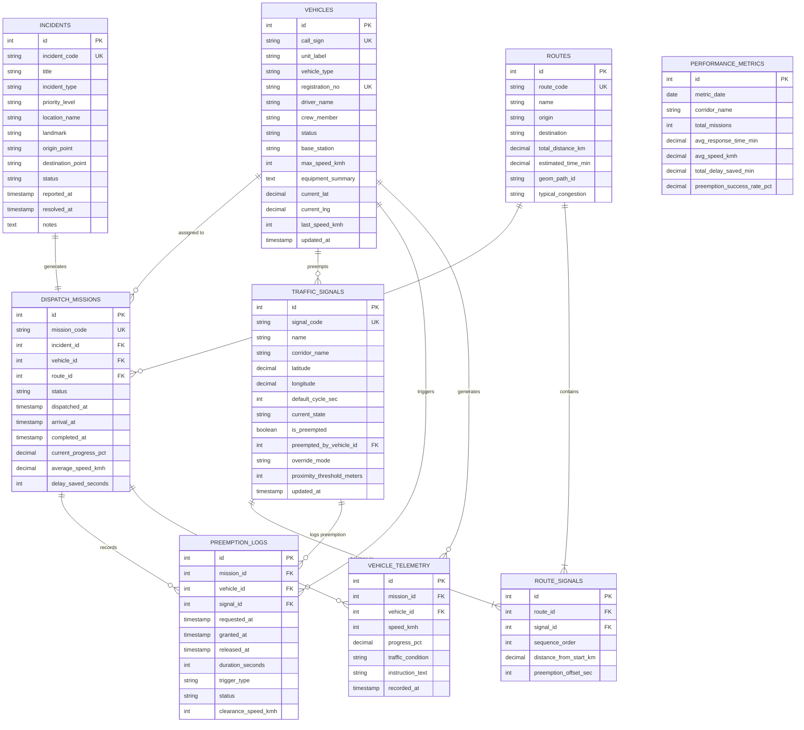

# 🗺️ Entity-Relationship (ER) Model & Data Dictionary

**Project:** Pulse · Smart Traffic & Emergency Route Management  
**Module:** Operating Systems & Relational DBMS Architecture  
**Module:** Database Layer (`/database`)

---

## 1. Visual Entity-Relationship Diagram (Mermaid)

---

## 2. Relational Schema Data Dictionary

### Table 1: `vehicles`
| Column | Type | Constraints | Description |
|---|---|---|---|
| `id` | INTEGER | PK, AUTO_INCREMENT | Unique vehicle ID |
| `call_sign` | VARCHAR(50) | NOT NULL, UNIQUE | Fleet designation (e.g., `'108 Ambulance A-12'`) |
| `unit_label` | VARCHAR(30) | NOT NULL | Short badge (e.g., `'Ambulance A-12'`) |
| `vehicle_type` | VARCHAR(40) | NOT NULL | Emergency category (Trauma, Police, Fire, Bike) |
| `registration_no` | VARCHAR(20) | NOT NULL, UNIQUE | Government vehicle RTO plate |
| `driver_name` | VARCHAR(100) | NOT NULL | Assigned pilot |
| `crew_member` | VARCHAR(100) | NULL | Paramedic or accompanying officer |
| `status` | VARCHAR(25) | NOT NULL, DEFAULT `'AVAILABLE'` | `'AVAILABLE'`, `'EN_ROUTE'`, `'ON_SCENE'`, `'MAINTENANCE'` |
| `base_station` | VARCHAR(100) | NOT NULL | Home station / depot |
| `max_speed_kmh` | INTEGER | NOT NULL | Vehicle top speed capability |
| `equipment_summary` | TEXT | NULL | On-board medical/rescue apparatus |
| `current_lat` | DECIMAL(10,6) | NULL | Real-time GPS Latitude |
| `current_lng` | DECIMAL(10,6) | NULL | Real-time GPS Longitude |
| `last_speed_kmh` | INTEGER | DEFAULT 0 | Instantaneous telemetry speed |

---

### Table 2: `traffic_signals`
| Column | Type | Constraints | Description |
|---|---|---|---|
| `id` | INTEGER | PK, AUTO_INCREMENT | Unique junction signal ID |
| `signal_code` | VARCHAR(30) | NOT NULL, UNIQUE | Hardware intersection code (`SIG-MUM-01`) |
| `name` | VARCHAR(100) | NOT NULL | Intersection name (e.g. Bandra Kalanagar Signal #1) |
| `corridor_name` | VARCHAR(100) | NOT NULL | Arterial road/expressway corridor |
| `latitude` | DECIMAL(10,6) | NOT NULL | Geospatial coordinates |
| `longitude` | DECIMAL(10,6) | NOT NULL | Geospatial coordinates |
| `default_cycle_sec`| INTEGER | NOT NULL, DEFAULT 90 | Normal non-emergency cycle time |
| `current_state` | VARCHAR(20) | NOT NULL | `'GREEN'`, `'YELLOW'`, `'RED'`, `'PREEMPTED'` |
| `is_preempted` | BOOLEAN | NOT NULL, DEFAULT 0 | 1 = Preemption hold active, 0 = Normal |
| `preempted_by_vehicle_id` | INTEGER | FK -> `vehicles(id)` | Vehicle currently holding the green phase |
| `override_mode` | VARCHAR(25) | DEFAULT `'AUTO'` | `'AUTO'`, `'MANUAL_GREEN'`, `'HOLD_ALL_RED'` |
| `proximity_threshold_meters` | INTEGER | DEFAULT 150 | Trigger distance threshold for preemption wave |

---

### Table 3: `incidents`
| Column | Type | Constraints | Description |
|---|---|---|---|
| `id` | INTEGER | PK, AUTO_INCREMENT | Unique incident ID |
| `incident_code` | VARCHAR(30) | NOT NULL, UNIQUE | Human-readable ID (`INC-MUM-2026-001`) |
| `title` | VARCHAR(150) | NOT NULL | Incident header (e.g. Critical Cardiac Emergency · BKC) |
| `incident_type` | VARCHAR(40) | NOT NULL | `'MEDICAL'`, `'FIRE'`, `'POLICE'`, `'TRAUMA'` |
| `priority_level` | VARCHAR(20) | NOT NULL | `'CRITICAL'`, `'HIGH'`, `'MEDIUM'`, `'LOW'` |
| `location_name` | VARCHAR(150) | NOT NULL | Street / Landmark address |
| `origin_point` | VARCHAR(100) | NOT NULL | Dispatch starting location |
| `destination_point`| VARCHAR(100) | NOT NULL | Target destination (Hospital / Police HQ / Port) |
| `status` | VARCHAR(25) | NOT NULL | `'REPORTED'`, `'DISPATCHED'`, `'RESOLVED'` |
| `reported_at` | TIMESTAMP | DEFAULT CURRENT_TIMESTAMP | Incident creation timestamp |
| `resolved_at` | TIMESTAMP | NULL | Incident closure timestamp |

---

### Table 4: `routes` & Table 5: `route_signals` (Junction Table)
- **`routes`**: Contains baseline corridor path geometry, distance in km, baseline travel time, and typical congestion level.
- **`route_signals`**: Resolves the **Many-to-Many** relationship between `routes` and `traffic_signals`, ordering the signals encountered along the corridor with `sequence_order` and distance milestones.

---

### Table 6: `dispatch_missions`
| Column | Type | Constraints | Description |
|---|---|---|---|
| `id` | INTEGER | PK, AUTO_INCREMENT | Primary mission ID |
| `mission_code` | VARCHAR(30) | NOT NULL, UNIQUE | Dispatch identifier (`MIS-MUM-4401`) |
| `incident_id` | INTEGER | FK -> `incidents(id)` | Related emergency call |
| `vehicle_id` | INTEGER | FK -> `vehicles(id)` | Dispatched vehicle unit |
| `route_id` | INTEGER | FK -> `routes(id)` | Assigned transit corridor |
| `status` | VARCHAR(25) | NOT NULL | `'DISPATCHED'`, `'IN_TRANSIT'`, `'COMPLETED'` |
| `dispatched_at` | TIMESTAMP | DEFAULT CURRENT_TIMESTAMP | Mission start timestamp |
| `current_progress_pct`| DECIMAL(5,2)| DEFAULT 0.00 | Progress along route (0-100%) |
| `delay_saved_seconds`| INTEGER | DEFAULT 0 | Cumulative seconds saved via preemption |

---

### Table 7: `preemption_logs`
Audit record of every traffic signal priority intervention. Critical for safety compliance and calculating response-time delta for the project report.

---

## 3. Relational Schema Normalization Analysis

- **1NF (First Normal Form):** Every attribute contains atomic values (no repeating groups, no comma-separated fields). Each record is uniquely identified by a primary key.
- **2NF (Second Normal Form):** Satisfies 1NF, and all non-key attributes are fully functionally dependent on the entire primary key (no partial dependencies). In the `route_signals` junction table, `distance_from_start_km` depends on the combination of `(route_id, sequence_order)`.
- **3NF (Third Normal Form):** Satisfies 2NF, and no non-key attribute is transitively dependent on another non-key attribute. For instance, signal corridor name and default cycle are stored in `traffic_signals`, not repeated inside `preemption_logs` or `dispatch_missions`.
